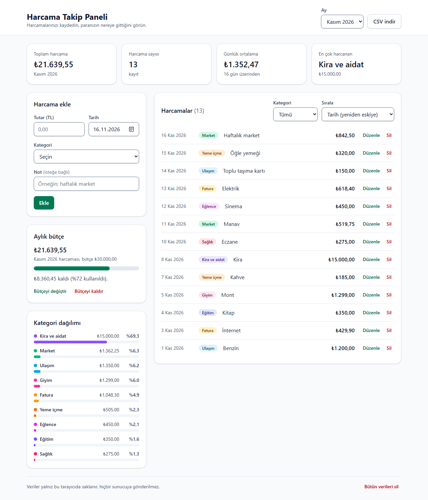

# Harcama Takip Paneli

Harcamalarınızı kategorisiyle kaydeden, paranızın nereye gittiğini gösteren ve aylık bütçenizi izleyen bir web uygulaması. React, Vite ve Tailwind CSS ile yazıldı; veriler yalnız tarayıcının LocalStorage alanında saklanır, hiçbir sunucuya gönderilmez.

**Canlı:** https://axelxoket.github.io/expense-tracker-dashboard/
**Örnek verilerle:** https://axelxoket.github.io/expense-tracker-dashboard/?ornek (panel boşsa örnek harcamalar yüklenir)
**Kaynak kod:** https://github.com/AxelXoket/expense-tracker-dashboard



Web Geliştirme eğitiminin uygulama projesidir ("Yapay Zeka Destekli Web Geliştirme").

## Özellikler

- **Harcama ekleme:** tutar, tarih, kategori ve isteğe bağlı not. Tutar Türkçe biçimde yazılır ("1.250,50"). Hatalı alanın altında Türkçe hata mesajı çıkar, odak ilk hatalı alana geçer. Kategori ve tarih bir sonraki kayıt için dolu kalır.
- **Düzenleme ve silme:** silinen harcama "Geri al" ile geri gelir. Bu seçenek 6 saniye sonra kapanır. Klavye odağı ya da fare imleci üzerindeyken süre işlemez; ikisi de ayrılınca 6 saniye baştan başlar.
- **Özet kartları:** seçili ayın toplamı, harcama sayısı, günlük ortalama (içinde bulunulan ayda bugüne kadarki gün sayısına göre) ve en çok harcanan kategori.
- **Kategori dağılımı:** seçili ayda her kategorinin tutarı ve payı. Paylar tek ondalık basamakla yazılır ve toplamları her zaman tam %100,0 olur (en büyük kalan yöntemi). Yuvarlanınca sıfıra düşen pay "<%0,1" olarak yazılır.
- **Aylık bütçe:** tek bir aylık tutar; seçili ayın harcaması ona göre izlenir. İlerleme çubuğu ve kalan tutar gösterilir. Harcama bütçenin %80'ine ulaşınca "Bütçenin sonuna yaklaştınız", bütçeyi aşınca aşım uyarısı çıkar. Yüzde yalnız tam bütçede %100 yazar, aşımda en az %101.
- **Ay, kategori ve sıralama:** ay seçici harcaması olan ayları ve içinde bulunulan ayı listeler; son harcaması silinen ay, seçili kaldığı sürece listede kalır. Liste kategoriye göre süzülür, tarihe ya da tutara göre sıralanır.
- **CSV indirme:** ekrandaki liste CSV dosyası olarak iner. Dosya Türkçe ayarlı Excel için hazırlanır: alanlar noktalı virgülle ayrılır, ondalık virgüldür, Türkçe harfler için başta BOM vardır. Dosya adı ayı ve seçili kategoriyi taşır, örneğin `harcamalar-2026-11-market.csv`. Formül gibi başlayan notlar (=, +, -, @, sekme, satır başı) hücrede çalışmasın diye başına kesme işareti alır.
- **Karanlık tema:** işletim sisteminin ayarını izler.
- **Klavye ve ekran okuyucu:** bütün düğmeler ve alanlar standart HTML öğeleridir, her işlem klavyeyle yapılır. Silmeden sonra odak "Geri al" düğmesine geçer; düzenleme bitince harcamanın satırına döner. Her alanın etiketi ve hata mesajı alana bağlıdır, ekran okuyucu ikisini birlikte okur. Durum mesajları hangi harcamanın eklendiğini, değiştiğini ya da silindiğini söyler. Düzenlenen satır renkten başka "Düzenleniyor" yazısıyla da işaretlenir.

## Veri ve güvenlik

- Tutarlar kuruş olarak tam sayıyla tutulur; toplamlarda kayan nokta hatası olmaz.
- Kayıt anahtarı `harcama-paneli:v1`. Okunamayan kayıt silinmez: ham hâli `harcama-paneli:yedek:<zaman>` anahtarına kopyalanır, sayfa uyarıyla açılır. Aynı bozuk metin bir kez yedeklenir. Yedek de yazılamazsa (depolama dolu) uygulama eski kaydın üzerine hiç yazmaz. "Bütün verileri sil" yedekleri de siler.
- Başka bir sekmede kaydedilen değişiklik bu sayfaya hemen yansır; buradaki sonraki değişiklik onun üstüne kaydedilir, sayfanın eski hâlinin üstüne değil. İki sekmede aynı anda yapılan iki kayıttan sonuncusu geçerli olur. Düzenlenen harcama öteki sekmede silinirse form kapanır ve bunu söyler.
- Sayfayı açmak kaydı değiştirmez; kayıt ilk değişiklikle yazılır. Örnek verilerle açılan bağlantı da siz bir değişiklik yapana kadar hiçbir şey kaydetmez.
- Yayındaki sayfa bir Content Security Policy taşır: yalnız sitenin kendi dosyaları çalışır.
- Tarayıcı depolaması alan adına bağlıdır. Site `axelxoket.github.io` alan adında yayında olduğu için aynı hesabın öteki GitHub Pages projeleri de aynı depolamayı görebilir. Kendi kopyanızı yayınlıyorsanız ayrı bir alan adı kullanın.

## Kullanılan teknolojiler

| Araç | Sürüm | Görevi |
|---|---|---|
| React | 19.3.1 | Arayüz |
| Vite | 8.3.8 | Geliştirme sunucusu ve derleme |
| Tailwind CSS | 4.3.5 | Stil (`@tailwindcss/vite` eklentisiyle) |
| Vitest | 5.1.0 | Test çalıştırıcı |
| Testing Library | React 16.3.3, user-event 14.6.11 | Kullanıcının gördüğünü sınayan testler |
| jsdom | 29.1.1 | Testlerde tarayıcı ortamı (31.x, denenen Node 24.11'i desteklemiyor) |
| Stryker | 10.1.1 | Mutasyon testi |
| gh-pages | 6.3.0 | GitHub Pages'e yayın |

Node `^22.18.0 || ^24.11.0 || >=26.0.0` gerekir (bağımlılıkların ortak aralığı); Node 24.11.1 ile denendi.

## Kurulum ve çalıştırma

```bash
git clone https://github.com/AxelXoket/expense-tracker-dashboard.git
cd expense-tracker-dashboard
npm install
npm run dev        # http://localhost:5173/expense-tracker-dashboard/
npm run build      # dist/ klasörüne derler
npm run preview    # derlenmiş sürümü http://localhost:4173/expense-tracker-dashboard/ adresinde açar
npm run deploy     # derler ve dist/ klasörünü gh-pages dalına yükler
```

Yayın için iki not:

- `npm run deploy` ilk kez çalıştıktan sonra GitHub'da depo ayarlarının Pages bölümünde kaynak olarak `gh-pages` dalı seçilir.
- `vite.config.js` içindeki `base` değeri depo adıdır (`/expense-tracker-dashboard/`). Depo başka bir adla çatallanırsa bu değer de değişmelidir; yoksa sayfa boş açılır.

## Testler

```bash
npm run test:gate  # kütüphane testleri, yaklaşık 1 saniye
npm test           # bütün testler
npm run mutation   # Stryker: kodu bilerek bozar, testlerin yakaladığını ölçer
```

`test:gate` her commit'ten önce yerel bir pre-commit kancasıyla koşar. Kanca `.git/hooks` altında durduğu için depoyla birlikte gelmez.

190 test, hepsi geçiyor:

- `src/lib` altında 105 kütüphane testi: tutar okuma, tarihler, aylık özet, paylar, CSV, bütçe yüzdesi, kayıt okuma ve yedekleme.
- 83 arayüz testi: Testing Library ile ekranda görüneni sınar. Ekleme ve hata mesajları, düzenleme, geri alma ve süresi, bütçe, ay ve süzgeç, CSV indirme, iki sekme, bozuk ya da dolu depolama, klavye odağı ve durum mesajları.
- 2 derleme testi: yayındaki sayfanın Content Security Policy'si.

Stryker son koşuda 1004 geçerli bozmanın hepsini yakaladı (%100; eşik %85). 60 bozma sayım dışıdır: 36'sı örnek verilerin not metninde, 16'sı yalnız stil sınıfında, 8'i davranışı değiştirmeyen satırlardadır; bu satırlar kodda gerekçesiyle işaretlidir. Kodu derlenemez yapan 15 bozma da sayılmaz.

Elle denetlenenler: karanlık tema ve telefon genişliği ekran görüntüleriyle denendi. Örnek veri bağlantısı (`?ornek`) ve Content Security Policy derlenmiş sürümde tarayıcıda denendi; konsolda hata yok.

## Yapay zekâyı nerede ve nasıl kullandım

Geliştirmede yapay zekâ asistanı olarak Claude'u (Claude Code) kullandım. Önerilen hiçbir kod testsiz kalmadı.

- **Planlama:** ekranlar (özet kartları, form, bütçe, dağılım, liste) ve veri modeli. Tutarları kuruş olarak tam sayıyla, tarihleri yerel takvim günü olarak saklama kararı bu aşamada çıktı.
- **Bileşenler:** form, bütçe kartı ve liste bileşenlerinin ilk sürümleri; Türkçe metinler ve erişilebilirlik ayrıntıları sonra düzeltildi.
- **Hata ayıklama:** kırmızı testlerin kök nedeni. Örnekler: `Blob.text()` CSV'nin başındaki BOM işaretini siliyordu; jsdom 31 kullandığım Node sürümüyle uyumsuzdu, 29.1.1'e indim.
- **Kod incelemesi:** ayrı bir yapay zekâ oturumu alan mantığını sert bir gözle inceledi. Bulduğu açıklar kapatıldı: yedek yazılamadığında eski kaydın ezilmesi, CSV'de formül enjeksiyonu (`src/lib/expenses.js`), iki sekmenin birbirinin kaydını ezmesi (`src/App.jsx`, `storage` olayı).
- **Doğrulama:** davranış testleri ekranda görüneni sınıyor; Stryker mutasyon testi testlerin hatayı gerçekten yakaladığını ölçüyor.

## Proje yapısı

```
src/lib/money.js           Türkçe tutar okuma ve biçimleme (kuruş)
src/lib/dates.js           yerel takvim günü, ay adları
src/lib/expenses.js        doğrulama, aylık özet, sıralama, CSV, bütçe
src/lib/storage.js         LocalStorage okuma, yedekleme, kaydetme
src/lib/categories.js      kategoriler
src/lib/sample.js          örnek veriler
src/components/            form, bütçe, özet, dağılım, liste ve geri alma bileşenleri
src/useFocusAfterRender.js bir işlemden sonra klavye odağını taşır
src/ui.js                  ortak stil sınıfları, kategori ve bütçe renkleri
src/App.jsx                durum, kayıt, geri alma, CSV indirme
src/**/*.test.js(x)        testler
src/test/                  test ortamı ve ortak test yardımcıları
docs/ekran-goruntusu.png   ekran görüntüsü
```
